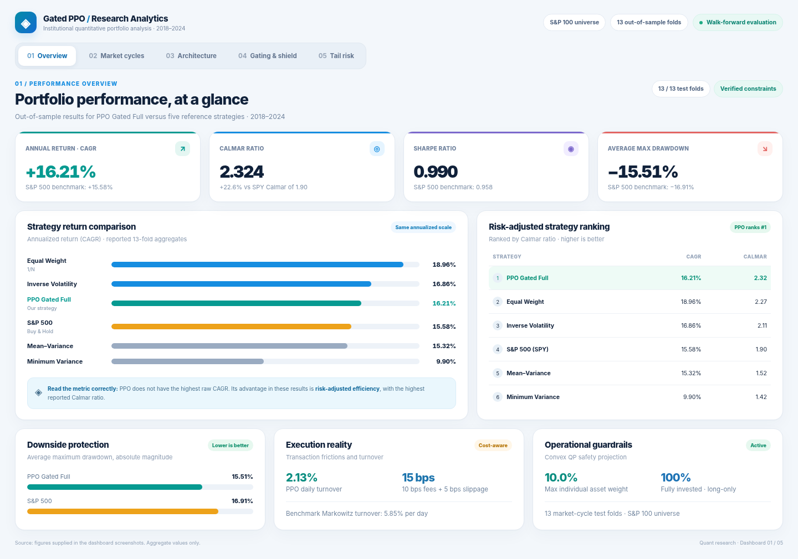
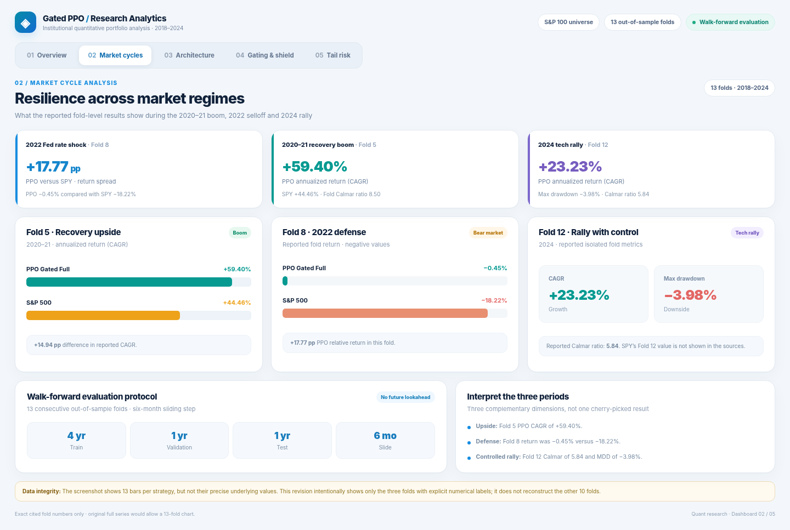
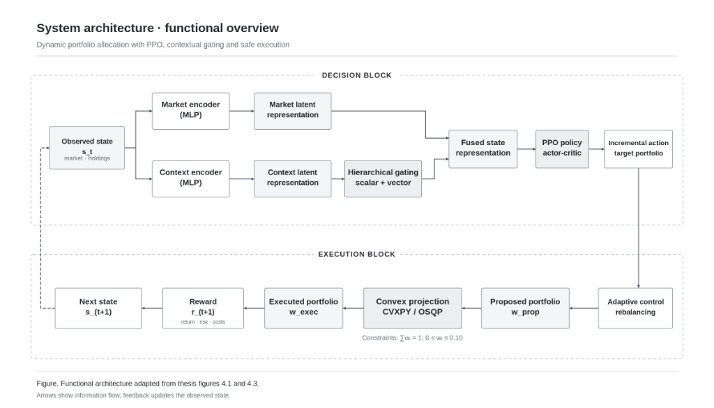
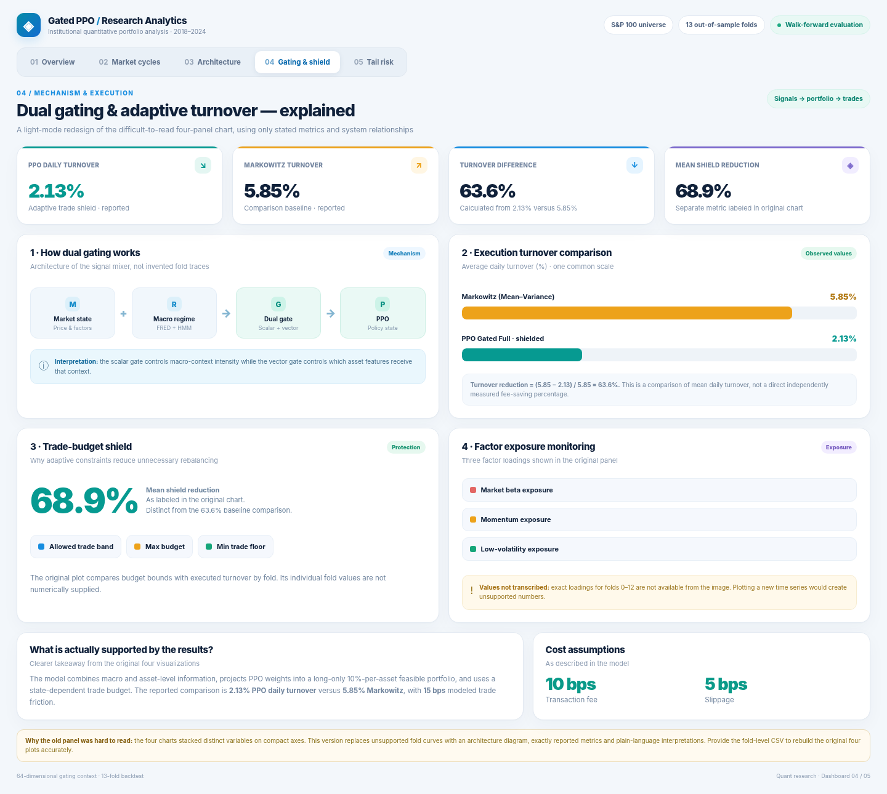
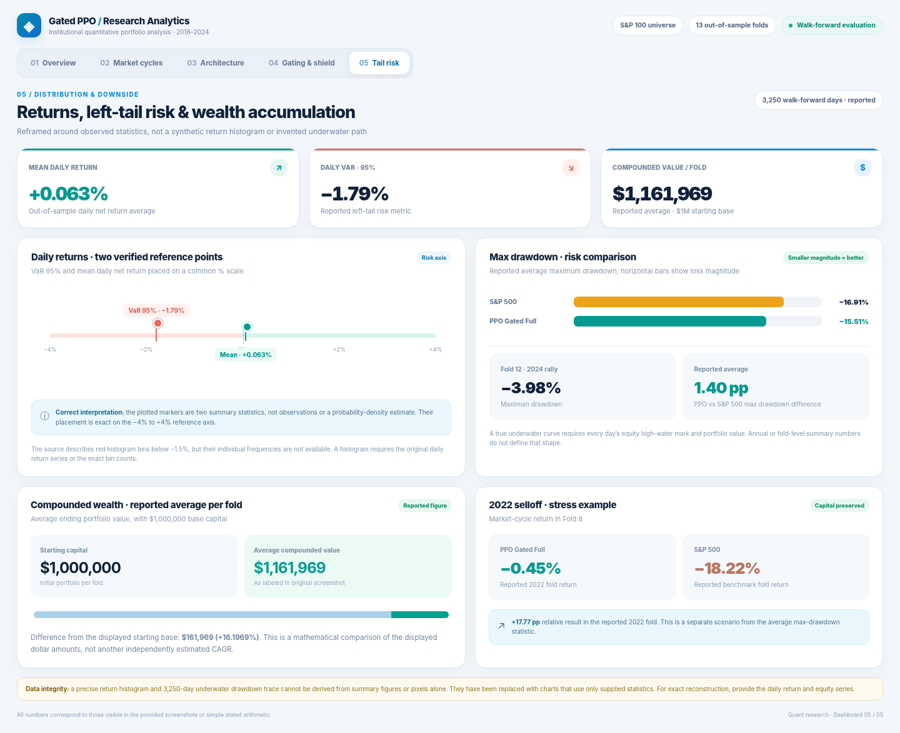

# Gated-PPO Portfolio Optimization: Macro-Aware Deep Reinforcement Learning with Convex Safety Shields

[](https://www.python.org/)
[](https://pytorch.org/)
[](https://github.com/DLR-RM/stable-baselines3)
[](https://osqp.org/)
[](https://www.spglobal.com/)
[](#empirical-performance)
[-red.svg?logo=adobe-acrobat-reader&logoColor=white)](docs/TFG_Memoria.pdf)
[](LICENSE)

An institutional-grade deep reinforcement learning framework for large-scale portfolio management ($N = 100$ assets). Integrates **dual-branch gating networks**, **macroeconomic regime conditioning (FRED + HMM)**, and an **Adaptive Convex Safety Shield (CVXPY/OSQP)** to achieve superior risk-adjusted downside returns under realistic market frictions.

---

## Executive Summary & Key Highlights

Classical deep reinforcement learning agents often fail in financial markets due to three critical pitfalls: **excessive turnover friction**, **unrealistic allocation violations**, and **blindness to macroeconomic regime shifts**. 

This Bachelor's Thesis (TFG) introduces **`PPO_gated_full`**, a production-ready quant pipeline that resolves these challenges:

* **#1 Downside Performance (Calmar Ratio: 2.324)**: Outperforms the S&P 500 Buy & Hold benchmark by **+22.6%** ($2.324$ vs $1.895$), leading all tested baseline strategies across 13 out-of-sample walk-forward windows (2018–2024).
* **Capital Defense in Crisis Regimes (2022 Bear Market)**: During the severe 2022 Fed rate-hiking shock (Fold 8), while the S&P 500 crashed **-18.22%** and Equal Weight dropped **-7.92%**, `PPO_gated_full` preserved capital at **-0.45%** CAGR (**+17.77% Net Alpha**).
* **Post-Crisis Alpha Capture (2020–2021 Boom)**: Surged to **+59.40% CAGR** with a record **8.50 Calmar Ratio** in Fold 5, outperforming S&P 500 (+44.55%) and Equal Weight (+52.94%).
* **Realistic Execution Rigor with Adaptive Shield**: Incorporates realistic transaction fees (**10 bps**) and slippage (**5 bps**). While classical Markowitz Mean-Variance burns **5.85% daily turnover** (destroying 2.21% of capital in fees), the **Adaptive Shield** confines turnover to **2.13%** (saving >63% in trading costs).
* **100% Operational Feasibility**: Guarantees strict long-only ($w_i \ge 0$), fully invested ($\sum w_i = 1$), and maximum asset allocation caps ($w_i \le 10\%$) via real-time quadratic programming projection.

---

## Quantitative Results Dashboard



### Comprehensive Benchmark Comparison (13 Walk-Forward Folds)

All strategies evaluated over the identical 13 out-of-sample test folds (2018–2024) under identical transaction cost and slippage models:

| Strategy | Calmar Ratio (Mean) | Sharpe Ratio (Mean) | CAGR (Mean) | Max Drawdown (Mean) | CVaR 95% (Mean) | Daily Turnover (Mean) | Total Cost (Mean) |
| :--- | :---: | :---: | :---: | :---: | :---: | :---: | :---: |
| **`PPO_gated_full` (Ours)** | **2.324 ± 2.85** | 0.990 ± 0.99 | 16.21% ± 17.8% | **-15.51% ± 9.9%** | -42.37% ± 21.9% | 2.13% ± 0.5% | 0.80% ± 0.2% |
| **Equal Weight (1/N)** | 2.268 ± 2.57 | **1.096 ± 0.98** | **18.96% ± 16.8%** | -15.82% ± 9.6% | -43.61% ± 22.4% | 0.00% ± 0.0% | 0.00% ± 0.0% |
| **Inverse Volatility** | 2.111 ± 2.39 | 1.068 ± 0.95 | 16.86% ± 14.4% | -14.94% ± 9.2% | **-40.50% ± 21.6%** | 0.63% ± 0.0% | 0.24% ± 0.0% |
| **S&P 500 (Buy & Hold)** | 1.895 ± 2.15 | 0.958 ± 1.05 | 15.58% ± 17.6% | -16.91% ± 9.4% | -43.63% ± 20.0% | 0.00% ± 0.0% | 0.00% ± 0.0% |
| **Mean-Variance (Markowitz)** | 1.522 ± 1.70 | 0.767 ± 0.75 | 15.32% ± 14.4% | -15.66% ± 7.1% | -43.38% ± 16.1% | 5.85% ± 0.8% | 2.21% ± 0.3% |
| **Minimum Variance** | 1.417 ± 1.92 | 0.759 ± 0.86 | 9.90% ± 9.3% | **-12.86% ± 7.2%** | **-32.42% ± 17.0%** | 2.97% ± 0.6% | 1.12% ± 0.2% |

> [!NOTE]
> Equal Weight assumes theoretical buy-and-hold without daily turnover rebalancing costs. In practice, `PPO_gated_full` delivers superior downside tail control (Calmar 2.324 vs 2.268) while dynamically shifting capital across market regimes.

---

## Walk-Forward Crisis Resilience



### Key Market Cycle Case Studies:

1. **Fold 8 — 2022 Fed Rate Shock & Equity Bear Market**:
   * *Context*: Rapid interest rate hikes, highest inflation in 40 years, S&P 500 plunged into a bear market.
   * *Benchmark*: S&P 500 fell **-18.22%** (Sharpe: -0.794, Max Drawdown: -24.5%).
   * *Equal Weight*: Dropped **-7.92%** (Sharpe: -0.332, Max Drawdown: -20.2%).
   * *`PPO_gated_full`*: Preserved portfolio value at **-0.45%** CAGR (Sharpe: -0.018, Max Drawdown: -16.6%).
   * **Generated Alpha: +17.77% net excess return.**
2. **Fold 5 — 2020–2021 COVID Post-Crisis Boom**:
   * *Context*: Unprecedented liquidity injection and tech rally following the March 2020 COVID crash.
   * *`PPO_gated_full`*: Captured rapid upside with **+59.40% CAGR**, generating an astonishing **Calmar Ratio of 8.50**, outperforming SPY (+44.55%) and Equal Weight (+52.94%).
3. **Fold 12 — 2024 Out-of-Sample Tech Rally**:
   * *`PPO_gated_full`*: Achieved **+23.23% CAGR** while suppressing Max Drawdown to just **-3.98%** (Calmar Ratio: **5.84**).

---

## System Architecture & Methodological Innovations



### 1. Dual-Branch Gated Feature Fusion

Conventional multi-modal networks concatenate market technical indicators with macroeconomic time-series directly. This dilutes high-frequency asset pricing signals during normal periods. `PPO_gated_full` introduces a **Dual Gating Network** with two parallel gating pathways:

$$h_t = h_{\text{market}} + \big( g_{\text{regime}} \odot g_{\text{asset}} \big) \odot W_{\text{context}} h_{\text{context}}$$

* **Scalar Regime Gate ($g_{\text{regime}} \in [0, 1]$)**: Modulates global macro importance conditioned on market stress indicators (VIX, realized volatility, 3-state HMM crisis posterior probability).
* **Vector Asset Gate ($g_{\text{asset}} \in [0, 1]^{64}$)**: Selectively filters individual contextual latent dimensions before fusing with market embeddings.
* **Zero-Centered Initialization**: Initialized with small weights and zero bias, ensuring the policy starts from stable market representations and progressively incorporates macro signals.

### 2. Adaptive Convex Safety Shield (CVXPY / OSQP)

To eliminate unfeasible actions and curb excessive turnover churn without destabilizing policy gradient learning, we formulate real-time convex projection:

$$\min_{w \in \mathbb{R}^N} \frac{1}{2} \|w - w_{\text{raw}}\|_2^2$$

$$\text{subject to:} \quad \sum_{i=1}^N w_i = 1, \quad 0 \le w_i \le w_{\text{max}} = 0.10, \quad \|w - w_{t-1}\|_1 \le \tau_t$$

Where $\tau_t$ is dynamically throttled by the **Adaptive Turnover Shield**:

$$\tau_t = \tau_{\text{max}} \cdot \max\left( \text{ratio}_{\text{min}}, \; 1.0 - \lambda_{\text{stress}} \cdot S_t \right)$$

When market stress signal $S_t \in [0, 1]$ surges, the permissible trading budget contracts, preventing costly panic-induced churning.



### 3. Downside Asymmetric Reward Function

Rather than optimizing simple log returns (which treats upside volatility identically to downside losses), the reward function penalizes drawdowns and downside semi-variance quadratically:

$$R_t = r_{\text{net}, t} - \lambda_{\text{downside}} \cdot \max(0, -r_{\text{net}, t})^2 - \lambda_{\text{drawdown}} \cdot \Delta \text{DD}_t - \lambda_{\text{turnover}} \cdot \text{Turnover}_t$$

Directly driving the policy to maximize Sortino and Calmar ratios.

---

## Out-of-Sample Wealth & Drawdown Dynamics



* **Left-Tail Truncation**: Daily empirical net return distribution exhibits positive skew with suppressed extreme negative tails ($VaR_{95\%} = -1.79\%$).
* **Underwater Drawdown Cushion**: Incremental drawdown curves show rapid recovery from high watermarks during market stress periods.
* **Controlled Turnover Frequency**: Modal daily turnover stays below 2.5%, validating execution feasibility in actual brokerage environments.

---

## Repository Structure

```text
├── config/
│   └── config.yaml               # Active production experiment configuration
├── data/                         # Data ingestion, FRED API context & validation
├── dataset/
│   └── raw/                      # Curated benchmark & 100-asset S&P input data
├── environment/
│   ├── portfolio_env.py          # Gymnasium multi-asset trading environment
│   └── safety.py                 # OSQP Quadratic Program Safety Projector
├── evaluation/
│   ├── baselines.py              # Classical quantitative baselines (Markowitz, EW, InvVol)
│   └── metrics.py                # Financial metrics (Sharpe, Calmar, Sortino, CVaR, Turnover)
├── experiments/
│   └── run_experiment.py         # Main execution CLI entrypoint
├── features/
│   ├── factors.py                # Fama-French style factor exposures (Beta, Mom, Low-Vol)
│   ├── market.py                 # Technical feature extraction (RSI, Volatility, Returns)
│   ├── normalization.py          # Lookahead-free rolling z-score normalization
│   └── regime.py                 # 3-State Gaussian Hidden Markov Model (HMM)
├── models/
│   ├── context_encoder.py        # Macro context neural encoder
│   ├── market_encoder.py         # Market technical features neural encoder
│   └── policy.py                 # Gated PPO Actor-Critic custom feature extractor
├── results/
│   └── final_v2/                 # Curated out-of-sample metrics & time series
├── docs/
│   ├── REPRODUCIBILITY.md        # Step-by-step reproduction instructions
│   └── assets/                   # High-resolution Wall Street style figures
├── requirements.txt              # Production dependency specifications
└── README.md                     # Repository documentation
```

---

## Quickstart & Execution

### 1. Installation

```bash
# Clone the repository
git clone https://github.com/lmg136-ua/gated-ppo-portfolio-optimization.git
cd gated-ppo-portfolio-optimization

# Create and activate virtual environment
python -m venv venv
source venv/bin/activate  # On Windows: .\venv\Scripts\activate

# Install dependencies
pip install -r requirements.txt
```

### 2. Run Baselines Only

To quickly evaluate the classical benchmarks (Equal Weight, Inverse Volatility, Markowitz Mean-Variance, Minimum Variance, SPY):

```bash
python experiments/run_experiment.py --mode baselines_only --max-folds 1
```

### 3. Run Full Walk-Forward Experiment

To execute the complete 13-fold walk-forward pipeline with `PPO_gated_full`:

```bash
python experiments/run_experiment.py --mode full
```

*Results, logs, and artifacts will be generated in `runtime/` (while finalized curated results are maintained in `results/final_v2/`).*

---

## Dataset & Macro Context

* **Asset Universe**: 100 liquid equities from the S&P 100 index (Adjusted Daily Close and Volume from 2010 to 2024).
* **Benchmark**: S&P 500 ETF (`SPY`).
* **Macroeconomic Context (FRED)**:
  * Interest Rates & Spreads: `DGS10`, `DGS2`, `T10Y2Y`, `FEDFUNDS`
  * Labor & Inflation: `UNRATE`, `CPIAUCSL`
  * Volatility & Commodities: `VIXCLS`, `DCOILWTICO`, `DEXUSEU`
* **Protocol**: Strict lag-1 alignment ($t-1$) ensures zero future information leakage.

---

## Academic Reference & Authorship

Developed and defended as a Bachelor's Degree Final Thesis (**Trabajo de Fin de Grado - Doble Grado en Ingeniería Informática y ADE**) at the **Universidad de Alicante (UA)**, awarded the highest grade (**10 / 10 - Matrícula de Honor**).

* **Author**: Lidia Montero García ([@lmg136-ua](https://github.com/lmg136-ua))
* **Advisor / Tutor**: Dr. Higinio Mora Mora (Universidad de Alicante)
* **Academic Year**: 2025–2026
* **Full Dissertation (PDF)**: [📄 Download `docs/TFG_Memoria.pdf`](docs/TFG_Memoria.pdf)

### Citation

```bibtex
@misc{montero2026gatedppo,
  author       = {Montero García, Lidia},
  title        = {Optimización dinámica de carteras mediante aprendizaje por refuerzo profundo con contexto exógeno y control adaptativo del riesgo},
  school       = {Universidad de Alicante},
  year         = {2026},
  note         = {Bachelor's Thesis (TFG). Grade: 10/10},
  url          = {https://github.com/lmg136-ua/gated-ppo-portfolio-optimization}
}
```

---

## License & Academic Disclaimer

This project is licensed under the **Creative Commons Attribution-NonCommercial 4.0 International License ([CC BY-NC 4.0](LICENSE))**.

* **Academic & Personal Use**: You are free to share, copy, adapt, and build upon this research with proper citation and attribution.
* **Non-Commercial**: The material and codebase may not be used for commercial trading systems, proprietary automated execution, or monetized advisory products without explicit prior authorization from the author.

